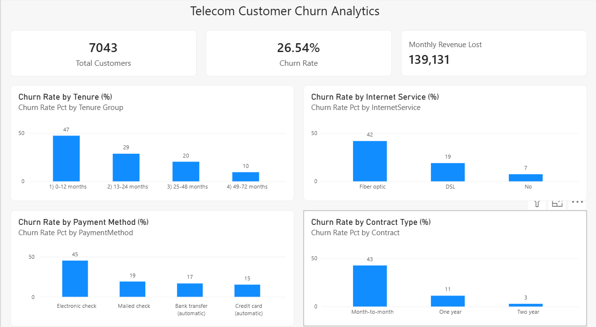
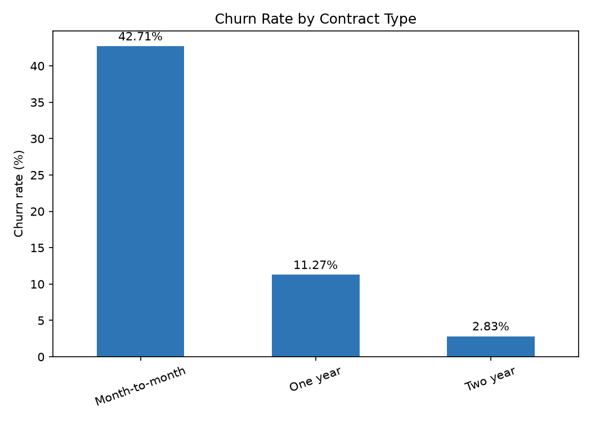
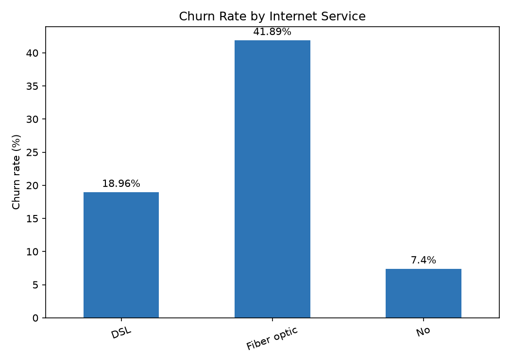
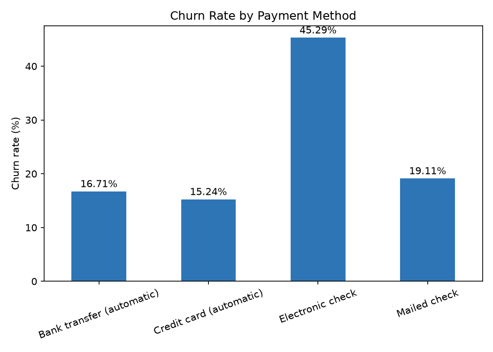
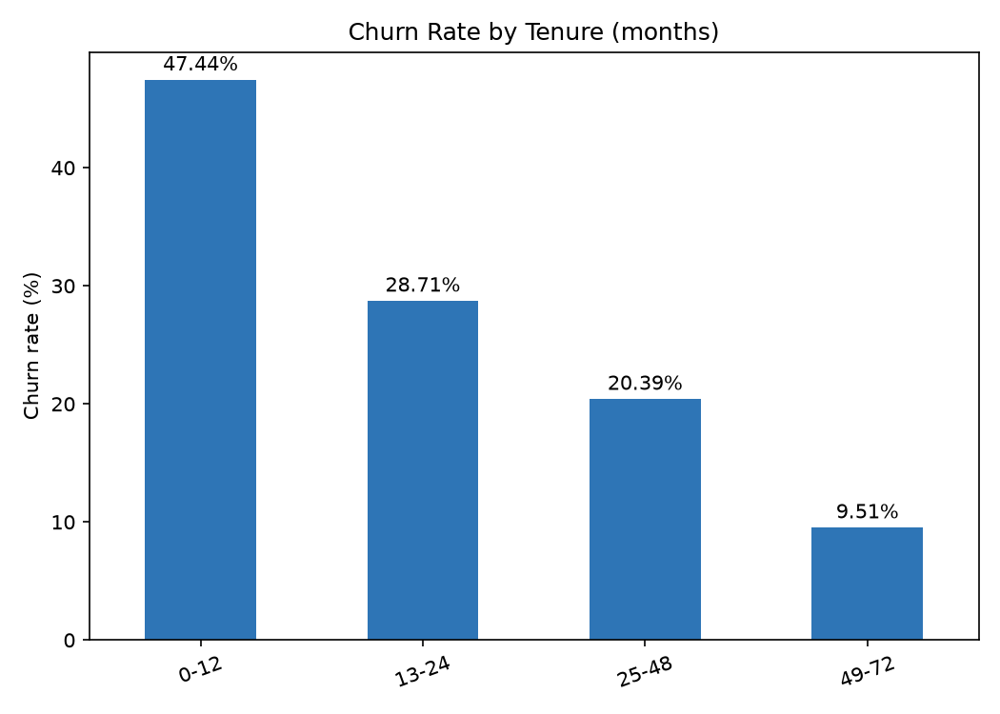

# Telecom Customer Churn Analytics

An end-to-end data analytics project that finds **which customers leave a telecom company, why they leave, and what the company should do about it.**

**Tools:** Python (Pandas, Matplotlib) · SQL Server (T-SQL) · Power BI (DAX)



---

## 1. Business Problem

A telecom company is losing customers every month. The business needs to know:

- How many customers are leaving, and how much revenue does this cost?
- Which customer groups leave the most?
- What actions can reduce churn?

## 2. Dataset

- **Source:** IBM Telco Customer Churn sample dataset (Kaggle)
- **Size:** 7,043 customers, 21 columns
- **Contents:** customer details, services, contract type, payment method, monthly and total charges, and a `Churn` column (Yes/No)

## 3. Project Workflow

| Step | What was done | Tool |
|---|---|---|
| 1. Understand | Checked shape, data types, missing values, duplicates | Python (Pandas) |
| 2. Clean | Fixed `TotalCharges` (text to number, 11 blank values for new customers set to 0); converted `SeniorCitizen` from 0/1 to No/Yes | Python (Pandas) |
| 3. Store | Created the `telecom_churn` database and loaded the cleaned data | SQL Server |
| 4. Analyze | Wrote business queries (churn by contract, internet service, payment method, tenure, revenue lost) | SQL (T-SQL) |
| 5. Visualize | Built charts and saved them as images | Python (Matplotlib) |
| 6. Dashboard | Built an interactive dashboard with KPI cards and 4 charts using DAX measures | Power BI |

## 4. Key Findings

| # | Finding | Evidence |
|---|---|---|
| 1 | Overall churn is high | **26.5%** of customers left (1,869 of 7,043) |
| 2 | Revenue lost to churn | About **139,131 per month**, which is **30.5%** of total monthly revenue |
| 3 | Month-to-month customers churn the most | **42.7%** churn vs **2.8%** for two-year contracts |
| 4 | Churn is concentrated in the first year | **47.4%** churn in months 0-12 vs **9.5%** for customers with 49+ months |
| 5 | Fiber optic customers churn more and pay more | **41.9%** churn at an average bill of **91.50**, vs DSL at **19.0%** and **58.10** |
| 6 | Payment method matters | Electronic check: **45.3%** churn; automatic payments: **15-17%** |

**Key insight:** **88.6%** of all customers who left were on month-to-month contracts.

## 5. Recommendations

1. **Move month-to-month customers to 1- or 2-year contracts** using discounts or bonus data. This targets the group where almost all churn happens.
2. **Focus on the first 12 months:** welcome offers, support calls at 30 and 90 days, and help with setup.
3. **Review fiber optic pricing and service quality.** Check whether customers leave because of price or service problems, and consider bundles or a lower-priced plan.
4. **Encourage automatic payments** with a small discount for customers who switch from electronic check.

**Estimated impact (illustrative):** retaining just 10% of churned month-to-month customers would save about **12,085 per month**, roughly 8.7% of the revenue currently lost to churn. This is an estimate based on current data, not a guarantee.

> Note: the data shows *where* churn is highest, not *why*. Reasons such as price or service quality are possible explanations and would need further research (for example, customer surveys) to confirm.

## 6. Dashboard

The Power BI dashboard includes:

- **KPI cards:** Total Customers, Churn Rate, Monthly Revenue Lost
- **Charts:** churn rate by contract type, internet service, payment method, and tenure group

Example DAX measures used:

```
Total Customers = COUNTROWS(telco_customers)
Churned Customers = CALCULATE(COUNTROWS(telco_customers), telco_customers[Churn] = "Yes")
Churn Rate = DIVIDE([Churned Customers], [Total Customers])
Monthly Revenue Lost = CALCULATE(SUM(telco_customers[MonthlyCharges]), telco_customers[Churn] = "Yes")
```

## 7. Charts (Python)

| | |
|---|---|
|  |  |
|  |  |

## 8. Project Structure

```
telecom-churn-analytics/
├── data/
│   ├── raw/          original dataset (never edited)
│   └── cleaned/      cleaned dataset used for analysis
├── notebooks/
│   ├── 01_data_understanding.ipynb
│   └── 02_eda_visuals.ipynb
├── sql/
│   └── 01_churn_analysis.sql
├── dashboard/
│   ├── telecom_churn_dashboard.pbix
│   └── dashboard_screenshot.png
├── docs/
│   └── charts/       chart images
└── README.md
```

## 9. How to Run

1. Clone this repository.
2. Create a Python environment and install the libraries: `pip install pandas numpy matplotlib seaborn ipykernel`
3. Run the notebooks in order (`01` then `02`).
4. In SQL Server, create a database named `telecom_churn`, create the `telco_customers` table, and load `data/cleaned/telco_churn_cleaned.csv`. Then run `sql/01_churn_analysis.sql`.
5. Open `dashboard/telecom_churn_dashboard.pbix` in Power BI Desktop and connect it to your SQL Server.

## 10. Author

**Muhammad Qais**
Aspiring Data Analyst

- LinkedIn: [Muhammad Qais](https://www.linkedin.com/in/muhammad-qais-38410b326)
- GitHub: [qais242004](https://github.com/qais242004)
- Email: muhammadqais865@gmail.com
